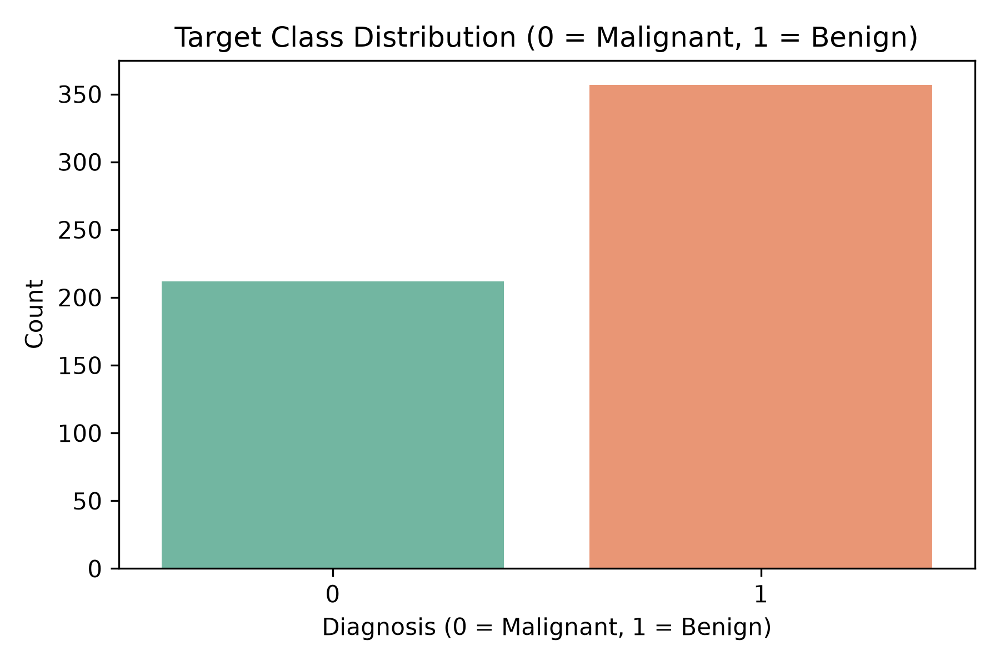
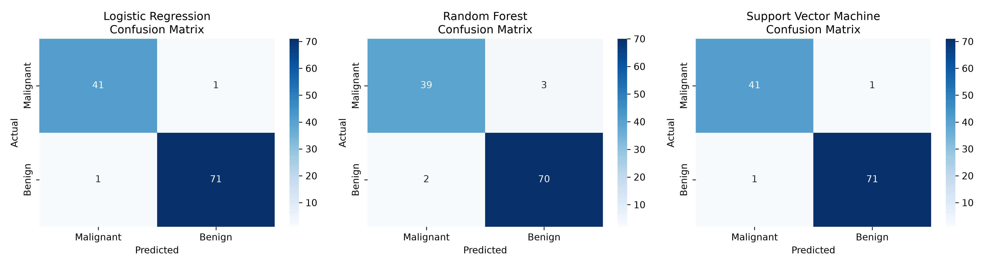
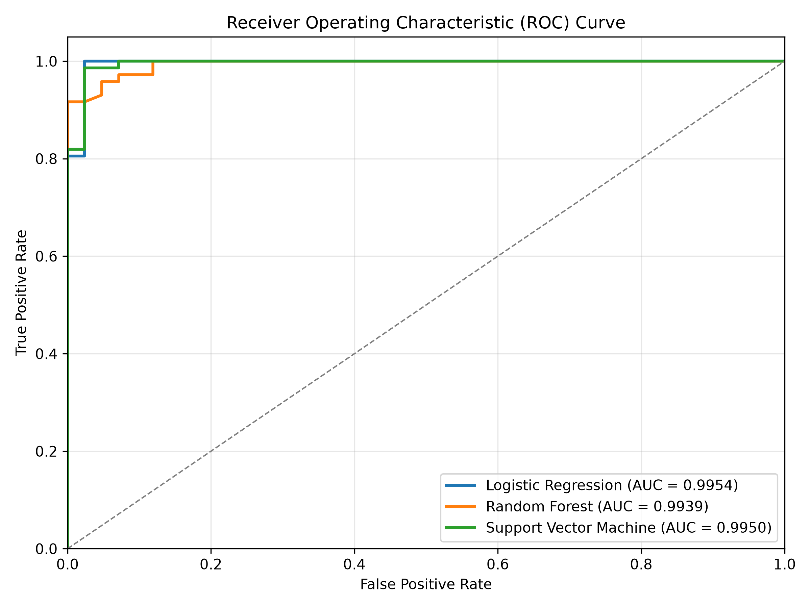
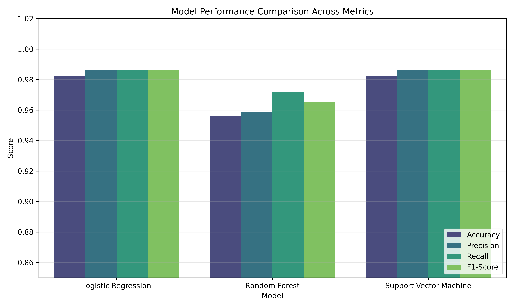

# Disease Prediction using Machine Learning

## Assignment Information

| Information | Details |
| :--- | :--- |
| **Title** | Disease Prediction using Machine Learning |
| **Course Title** | Special Study in Information and Communication Technology (Federated AI Security for Healthcare) |
| **Course Code** | ICT 6700 |
| **Course Teacher** | Dr. M A Moyeen - Assistant Professor, IICT, KUET |

## Student Information

| Information | Details |
| :--- | :--- |
| **Name** | Kakon Ray |
| **Roll No** | 2671561 |
| **Semester** | July-2026 |
| **Program** | M.Sc. Eng. in ICT |
| **University** | Khulna University of Engineering & Technology (KUET) |

---

## Project Overview
This project implements a complete machine learning pipeline to predict breast cancer diagnosis (**Malignant** vs. **Benign**) using clinical features. It covers data exploration, preprocessing, training multiple classification algorithms, and evaluating their performance using standard medical metrics.

## Dataset
* **Name:** Breast Cancer Wisconsin (Diagnostic) Dataset
* **Source:** Loaded directly from `scikit-learn` (`sklearn.datasets.load_breast_cancer`)
* **Total Instances:** 569 patient records
* **Features:** 30 numerical clinical features computed from digitized images of a fine needle aspirate (FNA) of a breast mass
* **Target Classes:** 
  * `0`: Malignant (212 samples)
  * `1`: Benign (357 samples)

## Repository Structure
```text
Disease-Prediction-ML/
├── results/
│   ├── class_distribution.png
│   ├── confusion_matrices.png
│   ├── roc_curves.png
│   └── model_comparison.png
├── disease_prediction.ipynb
└── README.md
```

## Methodology

### Phase A: Data Preprocessing
1. **Data Exploration:** Checked dataset dimensions (569 rows, 30 features) and verified there are zero missing or null values.
2. **Train-Test Split:** Split the dataset into **80% training** (455 samples) and **20% testing** (114 samples) using stratified sampling (`stratify=y`) to maintain class balance.
3. **Feature Scaling:** Applied `StandardScaler` to standardize all features (zero mean and unit variance) before training to improve convergence for linear and distance-based models.

### Phase B: Model Implementation
Three supervised classification models were trained on the scaled training dataset:
1. **Logistic Regression (LR):** Used as an interpretable baseline linear classifier.
2. **Random Forest Classifier (RF):** An ensemble tree-based classifier configured with 100 decision trees (`n_estimators=100`).
3. **Support Vector Machine (SVM):** Configured with an RBF kernel and probability estimation enabled (`probability=True`) to generate ROC curves.

### Phase C: Evaluation & Results
All models were evaluated on the unseen test set using **Accuracy, Precision, Recall, and F1-Score**.

| Model | Accuracy | Precision | Recall | F1-Score |
| :--- | :---: | :---: | :---: | :---: |
| **Logistic Regression** | 0.9825 | 0.9861 | 0.9861 | 0.9861 |
| **Random Forest** | 0.9561 | 0.9589 | 0.9722 | 0.9655 |
| **Support Vector Machine** | 0.9825 | 0.9861 | 0.9861 | 0.9861 |

## Visual Findings
All generated visualizations are stored in the `results/` directory:

* **Class Distribution:**  
  

* **Confusion Matrices:**  
  

* **ROC-AUC Curves:**  
  

* **Model Comparison:**  
  

## Conclusion
Both **Logistic Regression** and **Support Vector Machine (SVM)** achieved the highest overall accuracy (**98.25%**) and F1-score (**0.9861**). Their high recall (**98.61%**) shows strong reliability in minimizing false negatives, which is critical in medical disease prediction.